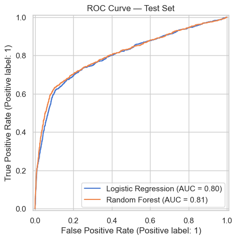
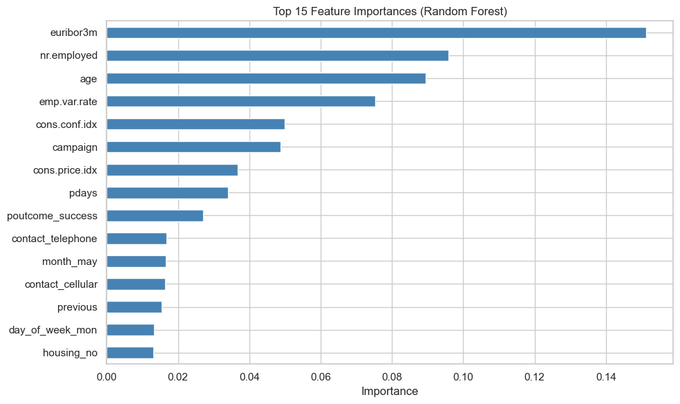

# Bank Marketing: Who Will Subscribe to a Term Deposit?

A Portuguese bank called clients to sell term deposits, and only **11%** said yes. I built models to predict which clients will subscribe, so a calling team can focus on the most likely customers instead of dialing everyone.

*Built for an upper-division machine learning class at UC Davis.*



## Results (held-out test set, 8,238 clients)
| Model | Precision | Recall | F1 | ROC-AUC |
|---|---|---|---|---|
| Logistic Regression (tuned, balanced) | 0.368 | **0.646** | 0.469 | 0.801 |
| **Random Forest** (tuned, balanced) | **0.457** | 0.616 | **0.525** | **0.808** |

- **Accuracy is misleading here.** Predicting "no" for everyone is 88.7% accurate and useless. I optimized F1 and checked recall and AUC instead.
- **Class weighting mattered most.** Without it, logistic regression's recall was 0.23; with `class_weight='balanced'` it jumped to 0.62.
- **Macroeconomic conditions drive the outcome.** The top Random Forest features were the 3-month Euribor rate, number employed, age, and the employment variation rate, more than anything about the call itself.



## What I did
1. **EDA**: class balance, age distribution by outcome, subscription rate by job.
2. **Preprocessing**:
   - Dropped `duration`, which is only known after the call ends, so keeping it would leak the outcome.
   - Kept "unknown" as its own category.
   - One-hot encoded the categorical features and scaled the numeric ones.
3. **Models**: Logistic Regression vs. Random Forest with 5-fold **stratified** cross-validation.
4. **Tuning**: `GridSearchCV` optimizing F1.
5. **Evaluation**: confusion matrices, ROC curves, precision/recall trade-off.
6. **Deep dives**: effect of class weighting, and feature importance with interpretation.

## Run it
```bash
pip install -r requirements.txt
jupyter notebook bank_marketing_classification.ipynb
```
The notebook shows my original run. Random Forest scores can shift slightly (±0.02 F1) on newer scikit-learn versions.

## Data
[Bank Marketing dataset](https://archive.ics.uci.edu/dataset/222/bank+marketing) (UCI Machine Learning Repository, CC BY 4.0). Moro, S., Rita, P., & Cortez, P. (2014). 41,188 calls, split 80/20 into `data/bank-train.csv` and `data/bank-test.csv`.

## Tools
Python · pandas · scikit-learn · matplotlib · seaborn
